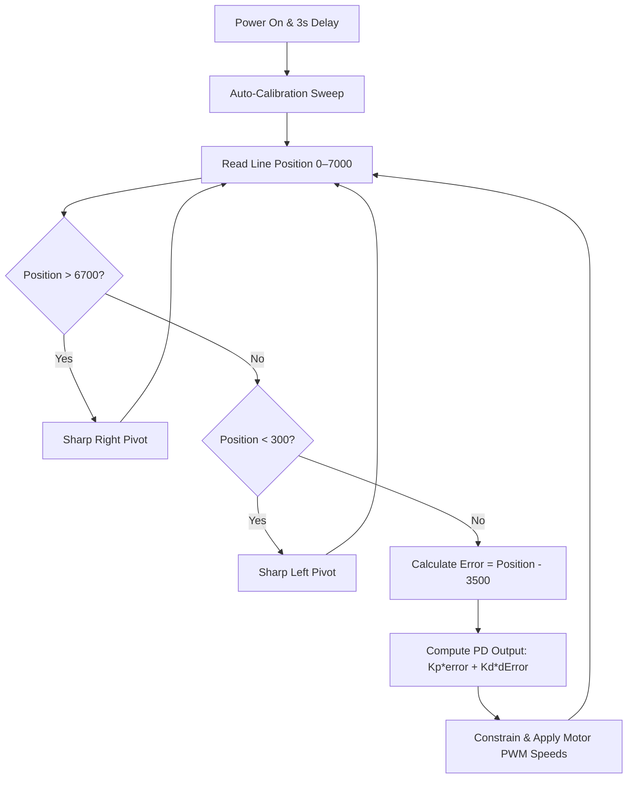

# pd-line-following-robot
Closed-loop PD-controlled Line Following Robot built on Arduino Nano (ATmega328P) with L298N and IR sensor array.
---

## Control Architecture

The robot uses an auto-calibration sweep at startup to map surface reflectance, then runs a continuous PD control loop to adjust left and right motor PWM speeds. Sharp turns are handled via threshold-based pivot overrides.

---

## Bill of Materials (BOM)

| Component | Specification / Notes |
| :--- | :--- |
| **Microcontroller** | Arduino Nano R3 (CH340, ATmega328P) |
| **Motor Driver** | L298N Dual H-Bridge DC Motor Driver |
| **Line Sensor** | IR Reflectance Sensor Array *(Firmware configured for 8-ch analog QTR-8A; prototyped with 5-ch TCRT5000 array)* |
| **Chassis & Motors** | 2WD Acrylic Chassis with Dual Yellow BO Geared Motors |
| **Power Supply** | 9V Battery with Snap Connector |

---

## Pinout Configuration

| Arduino Nano Pin | Connected Module | Function |
| :--- | :--- | :--- |
| `A0 – A7` | IR Sensor Array | Analog reflectance inputs |
| `D5` | L298N `ENA` | Left Motor PWM speed control |
| `D11` | L298N `IN1` | Left Motor direction control 1 |
| `D12` | L298N `IN2` | Left Motor direction control 2 |
| `D3` | L298N `ENB` | Right Motor PWM speed control |
| `D9` | L298N `IN3` | Right Motor direction control 1 |
| `D8` | L298N `IN4` | Right Motor direction control 2 |

---

## Tuned PD Parameters

The Integral (`I`) term is intentionally omitted to prevent integral windup during rapid directional changes on tight tracks.

* **Proportional Gain (`Kp`):** `2`
* **Derivative Gain (`Kd`):** `40`
* **Base Cruising Speed:** `155` (PWM)
* **Max Speed Cap:** `225` (PWM)
* **Pivot Turn Speed:** `100` (PWM)

---

## Dependencies & Setup

1. Install the **Pololu QTRSensors** library via the Arduino IDE Library Manager (`Sketch` → `Include Library` → `Manage Libraries`).
2. Select **Arduino Nano** and **ATmega328P (Old Bootloader)** if using a CH340 clone board.
3. Upload `line_follower.ino`. Upon powering on, the built-in LED lights up for 3 seconds before the bot sweeps left and right to calibrate over the line.
